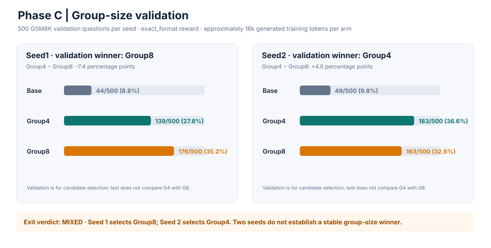
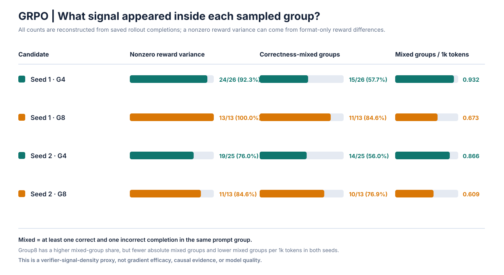
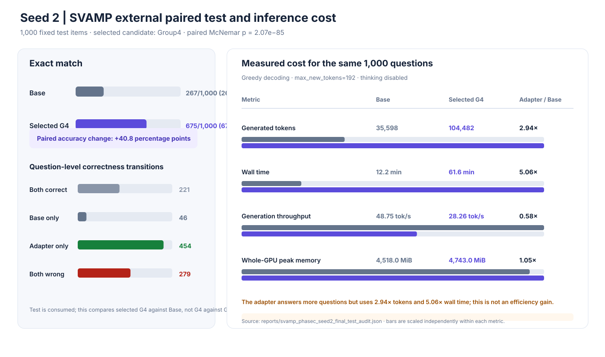

# Qwen3-0.6B GRPO / RLVR under a small GPU budget

一个完整、可审计的 Qwen3-0.6B 数学 RLVR 项目：在 WSL2 + RTX 3060 12GB 上用 GRPO、NF4 QLoRA、梯度检查点和 Transformers 原生生成完成可验证奖励训练、checkpoint 选择、独立评测与保存样本诊断。模型固定为 [`Qwen/Qwen3-0.6B`](https://huggingface.co/Qwen/Qwen3-0.6B/tree/c1899de289a04d12100db370d81485cdf75e47ca) revision `c1899de289a04d12100db370d81485cdf75e47ca`；训练生成设为 `use_vllm=False`。

> **Phase C 已完成，group-size 结论：MIXED。** 两个训练 seed 在约 16k 生成 token 预算下的 validation 胜者相反。未启动新的 GPU 训练，没有使用云端 GPU 或付费服务。完整状态见 [`docs/STATUS.md`](docs/STATUS.md)。

## 研究问题

在固定生成 token 预算下，把 GRPO 每个 prompt 的采样组从 4 条 completion 增加到 8 条，能否更有效地形成组内正确性信号？更大的组可能更常同时包含正确与错误答案，但在同样 token 预算下会减少训练 prompt 覆盖和优化更新数。实验比较这两种预算分配，并分析“组内信号”是否真的对应更好的 validation 表现。

### 结果图







图表由已保存的 JSON 结果通过 `scripts/plot_phasec_summary.py` 离线生成，不会重新运行模型或改变实验分数。

## GRPO 与奖励实现

对一个 prompt 采样 `G` 条答案，固定 verifier 分别给出奖励 `r_i`，再按组内奖励标准化计算优势：

```text
A_i = (r_i - mean(r_group)) / (std(r_group) + epsilon)
```

TRL 使用 clipped policy objective 更新 LoRA 参数；本项目没有 PPO 的单独 value/critic 网络。组内奖励方差为 0 时，该组没有相对优势信号。增加 `G` 可以增加同一题出现不同答案的机会，但会占用更多生成 token。

Phase C 使用 `exact_format` 奖励：verifier 可解析且答案正确得 1 分；唯一、合规的 `<answer>整数</answer>` 格式可额外得 0.05 分；错误但格式合规的整数仅得 0.05 分；无法解析得 0 分。因而“奖励有方差组”不必然包含正确 completion；报告还单独统计至少一对正确/错误 completion 同组出现的“正确性混合组”。历史 `distance_shaped` 实验保留为负结果，不覆盖或改写。

## 实验设计与环境

- **硬件：** WSL2 Ubuntu 24.04.3，NVIDIA GeForce RTX 3060 12GB。运行前记录 GPU 基线；训练同时记录 PyTorch allocated/reserved 与 `nvidia-smi` 整卡峰值。
- **软件：** Python 3.12.3、PyTorch 2.5.1+cu121（PyTorch CUDA runtime 12.1）、Transformers 4.57.3、TRL 1.16.0、PEFT 0.21.2、Accelerate 1.15.0、bitsandbytes 0.50.2；依赖锁见 [`requirements-wsl2.lock.txt`](requirements-wsl2.lock.txt)。驱动和运行时来源见 [`reports/environment.json`](reports/environment.json)。
- **训练：** NF4 + double quant，BF16，LoRA `r=8 / alpha=16 / dropout=0`；目标模块为 attention 与 MLP projection；gradient checkpointing 开启；每个设备一个 prompt；`gradient_accumulation_steps=G`；学习率 `5e-5`，`beta=0`，group reward scaling；prompt 与 completion 上限均为 256 token。
- **生成：** Transformers 原生 rollout，不使用 vLLM；`temperature=0.9`、`top_p=1.0`、`top_k=0`；训练和评测均关闭 Qwen thinking mode。
- **预算：** 训练在完整 generation group 结束后触及 16,000 completion-token 目标并停止。因此实际 token 数有组边界超额；不同 group size 的生成 token 接近，但更新数和 prompt 数不相等。
- **评测：** 固定 verifier；greedy decoding，`max_new_tokens=192`，thinking disabled；checkpoint 只按 locked validation 选择。最终 test 只评估所选 adapter 对 Base 一次。
- **隔离：** GSM8K 固定 revision、source row 与文件 hash；SVAMP 固定仓库 commit、source hash 与输出 hash。所有 train/validation/test overlap 和历史模型输出重叠检查均保存在 `reports/`。本地审计不能证明公开题目未出现在基础模型预训练数据中。

## Phase C 冻结结果

### 固定 token 预算下的 group-size 结果

| Seed | 组大小 | Validation exact match | 训练生成 tokens | 更新 / prompts | 训练生成 tok/s | 整卡训练峰值 |
|---|---:|---:|---:|---:|---:|---:|
| 1 | Group4 | 139/500 (27.8%) | 16,097 | 26 / 26 | 68.67 | 3,968 MiB |
| 1 | Group8 | **176/500 (35.2%)** | 16,354 | 13 / 13 | 106.85 | 4,399 MiB |
| 2 | Group4 | **183/500 (36.6%)** | 16,160 | 25 / 25 | 69.57 | 4,070 MiB |
| 2 | Group8 | 163/500 (32.6%) | 16,415 | 13 / 13 | 109.29 | 4,506 MiB |

seed 1 validation 选中 `runs/gsm8k-phasec-exact-g8-16k/attempt-01/trainer/checkpoint-13`；seed 2 选中 `runs/gsm8k-phasec-seed2-g4-16k/attempt-01/trainer/checkpoint-25`。每个 seed 的两组生成预算相差约 1.6%，但更新数约减半，不能把该对照描述为总计算量匹配。两个 seed 的赢家相反，结论为 **MIXED**；不支持稳定声称 Group8 或 Group4 更优。

### 独立测试与推理成本

| 一次性测试 | Base | Validation-selected adapter | 配对结果 | 生成 tokens（Base / Adapter） | wall time（Base / Adapter） | 推理整卡峰值（Base / Adapter） |
|---|---:|---:|---|---:|---:|---:|
| Seed 1 · GSM8K-train-source 1,000题 | 99/1,000 (9.9%) | Group8: 354/1,000 (35.4%) | McNemar p=2.12e-52；Base-only 32，Adapter-only 287 | 52,660 / 134,062 (2.55×) | 16.2 / 74.1 min (4.58×) | 3,485 / 3,504 MiB |
| Seed 2 · SVAMP 1,000题 | 267/1,000 (26.7%) | Group4: 675/1,000 (67.5%) | McNemar p=2.07e-85；Base-only 46，Adapter-only 454 | 35,598 / 104,482 (2.94×) | 12.2 / 61.6 min (5.06×) | 4,518 / 4,743 MiB |

两次 test 都只比较各自 validation 选中的 adapter 与 Base；没有在 test 上直接比较 Group4 与 Group8。Selected adapters 的准确率更高，但生成 token 更多、wall time 更长、token/s 更低，不能称为推理效率提升。上述测试已消费，不用于新候选的 checkpoint 选择或调参。

### 组内信号机制诊断

| Seed | Group4 正确性混合组 | Group8 正确性混合组 | Group4 / Group8 混合组每千 token |
|---|---:|---:|---:|
| 1 | 15/26 (57.7%) | 11/13 (84.6%) | 0.932 / 0.673 |
| 2 | 14/25 (56.0%) | 10/13 (76.9%) | 0.866 / 0.609 |

两 seed 的 Group8 正确性混合组比例更高，但绝对混合组数更少，且每千 token 的混合组密度更低。这是 verifier 信号密度代理，不是有效梯度、学习效率或因果收益。两个 seed 中 Group8 使用的 13 道 prompt 都包含在 Group4 覆盖内；共享 prompt 上的 rollout 样本准确率差分别为 +1.0pp 与 −1.0pp，方向也相反。详见 [`reports/phasec_seed2_diagnostic_report.md`](reports/phasec_seed2_diagnostic_report.md)。

### 保存预测的 post-hoc 输出长度分析

`reports/posthoc_prediction_length_audit.md` 从已保存的逐题输出离线统计长度、parse failures、正确性转换和聚合成本。它被明确标注为 **post-hoc**，不会修改原始准确率、答案解析器、测试阈值或 checkpoint 选择。

- Adapter 无法解析输出：Seed 1 GSM8K 为 260/1,000，Base 为 273；Seed 2 SVAMP 为 114/1,000，Base 为 167。
- Qwen tokenizer 长度是对保存的 decoded text 重新 tokenize，不是保存过的原始 generation token IDs；逐题 latency 也未记录。因此报告把字符、空白分词和重分词长度与真实聚合生成 token / wall time 分开。
- Adapter 的错误输出仍明显更长：Seed 1 重分词平均长度为正确 116.4、错误 142.4；Seed 2 为正确 93.7、错误 123.9。输出更长与本轮准确率提升同时出现，但不是提升的因果解释。

## 负结果与限制

- 100-update `distance_shaped` 正式实验的选中 adapter 在已消费的 1,063 题 test 上为 77/1,063，低于 Base 95/1,063。旧 rollout 中 89/100 组没有一个正确答案，其中 85 组仍因错误答案距离分而出现 reward variance；非零奖励方差不等于有效正确性信号。
- Fresh split 的 exact-format validation 为 190/500，distance-shaped 为 183/500，配对差异不显著（McNemar p=0.547）；该实验不证明某种 reward 稳定更好。
- Phase C 只有两个训练 seed，seed 结果互相矛盾。逐题 McNemar/bootstrap 描述题目层不确定性，不能代替跨训练 seed 方差估计。
- 测试报告中的 selected-vs-Base 提升不能归因为 group size，因为没有测试集上的 Group4-vs-Group8 成对比较；SVAMP 公开多年，也无法排除预训练污染。
- Adapter 在两份 Phase C test 上分别用了 2.55× 和 2.94× tokens、4.58× 和 5.06× 时间。该实验不构成成本归一化后的能力结论。
- 公开准确率严格保留原 exact-match/parser 结果；事后读者可发现模型有时算对但答案格式或表达式不合规，不能据此悄悄重算历史分数。

## 离线 smoke 与复现

在 WSL2 Ubuntu 中：

```bash
python3 -m venv ~/.venvs/qwen3-grpo
source ~/.venvs/qwen3-grpo/bin/activate
python -m pip install --upgrade pip
python -m pip install -r requirements-wsl2.lock.txt --extra-index-url https://download.pytorch.org/whl/cu121

# CPU-only smoke：单元测试与确定性工具环境 demo，不加载 Qwen 或启动训练
python -m unittest discover -s tests -v
python -m agent_rl.demo

# 离线复核已保存结果和图表
python scripts/verify_manifest.py --portable-only
python scripts/plot_phasec_summary.py
python scripts/audit_prediction_lengths.py \
  --case seed1_gsm8k reports/gsm8k_phasec_base_test.json reports/gsm8k_phasec_selected_test.json \
  --case seed2_svamp reports/svamp_phasec_seed2_base_test.json reports/svamp_phasec_seed2_selected_test.json \
  --output /tmp/posthoc-audit.json --markdown /tmp/posthoc-audit.md
```

要重跑真实 GRPO correctness smoke，需本地 CUDA GPU 与下载模型；本归档期间没有重跑此命令：

```bash
python scripts/audit_env.py --output reports/environment.json
python scripts/check_runtime.py
python scripts/validate_reward.py
python scripts/train_grpo.py --profile smoke --run-dir runs/smoke-repro
```

Phase C 训练协议复现示例（以下命令会启动本地 GPU 训练；此处仅作可复现说明，本次归档未执行）：

```bash
python scripts/train_grpo.py --profile formal --num-generations 4 --max-completion-length 256 --prompt-token-limit 256 --max-generated-tokens 16000 --seed 20261025 --learning-rate 5e-5 --reward-mode exact_format --train-data data/gsm8k-next-fresh/train.jsonl --run-dir runs/repro-phasec-seed1-g4
python scripts/train_grpo.py --profile formal --num-generations 8 --max-completion-length 256 --prompt-token-limit 256 --max-generated-tokens 16000 --seed 20261025 --learning-rate 5e-5 --reward-mode exact_format --train-data data/gsm8k-next-fresh/train.jsonl --run-dir runs/repro-phasec-seed1-g8
python scripts/eval_math.py --adapter runs/repro-phasec-seed1-g4/attempt-01/final_adapter --eval-data data/gsm8k-phasec/validation.jsonl --tag repro-seed1-g4-validation --output reports/repro-seed1-g4-validation.json --max-new-tokens 192
python scripts/eval_math.py --adapter runs/repro-phasec-seed1-g8/attempt-01/final_adapter --eval-data data/gsm8k-phasec/validation.jsonl --tag repro-seed1-g8-validation --output reports/repro-seed1-g8-validation.json --max-new-tokens 192
```

Seed 2 使用 `--seed 20261026`，validation 文件换成 `data/gsm8k-replication/validation.jsonl`。先按 locked validation 规则选 candidate；不可使用已消费的 Phase C test 对新候选调参。训练可能产生不同的组边界超额与更新数，需以新 run summary 如实报告。

## 目录与产物

- `scripts/`：环境审计、数据准备、奖励、GRPO 训练、独立评测、逐题配对、rollout 诊断、manifest 和图表生成。
- `tests/`：CPU 工具环境、runner 与 post-hoc 预测审计单元测试；数据隔离和 reward 验证结果保存在 `reports/`。
- `data/`：固定 splits 与 source manifests；数据许可和来源见 [`DATA_NOTICE.md`](DATA_NOTICE.md) 与每个数据目录的 README/LICENSE。
- `runs/`：训练日志、奖励历史、生成 completion parquet、配置和吞吐/显存摘要。大模型/optimizer/checkpoint 二进制不会提交到 Git。
- `reports/`：环境、预注册/选择、原始逐题预测、paired tests、训练曲线、post-hoc 诊断和报告。
- [`reports/artifact_manifest.json`](reports/artifact_manifest.json)：公开/可分发文件与本地权重文件分开记录 SHA-256 和字节数；用 `scripts/verify_manifest.py` 检查。
- `agent_rl/`：未来 Agent RL 的 CPU-only 确定性 tool environment 和 benchmark runner。**没有 Phase D 模型训练。**

## 数据、模型和分发范围

GSM8K pinned dataset card 声明 MIT；SVAMP 固定 commit 的 license 是 MIT；本仓库保留相应 notice。Qwen3-0.6B 上游模型仓库声明 Apache-2.0，但模型与 LoRA/checkpoint 权重不在 Git 中，使用者首次训练/推理时从固定 revision 下载。来源和边界见 [`DATA_NOTICE.md`](DATA_NOTICE.md)。项目没有额外对所有代码或派生产物作统一 license 声明。

## AutoDL 后续计划

AutoDL 单张 24GB GPU 计划见 [`reports/formal_training_plan.md`](reports/formal_training_plan.md)，当前暂停且不是本项目的云端训练结果或租用授权。GSM8K 官方 train 仅剩 23 条未用 source rows；SVAMP 已用于 Phase C seed 2 test。正式运行前必须选择新 validation/test 并完成数据审计。没有创建 AutoDL 实例，也没有使用任何付费服务。
