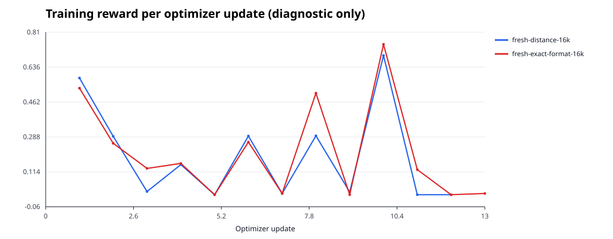
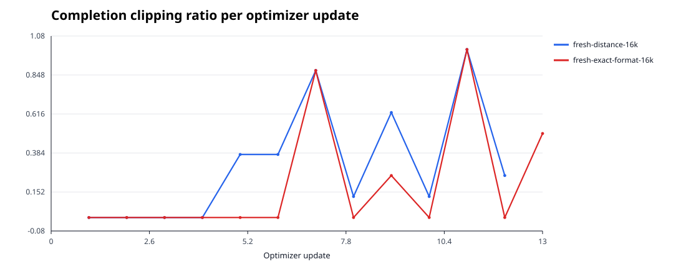
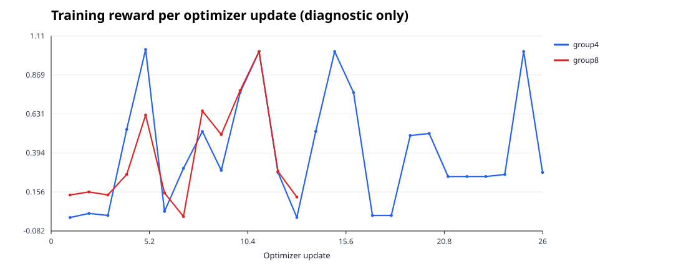
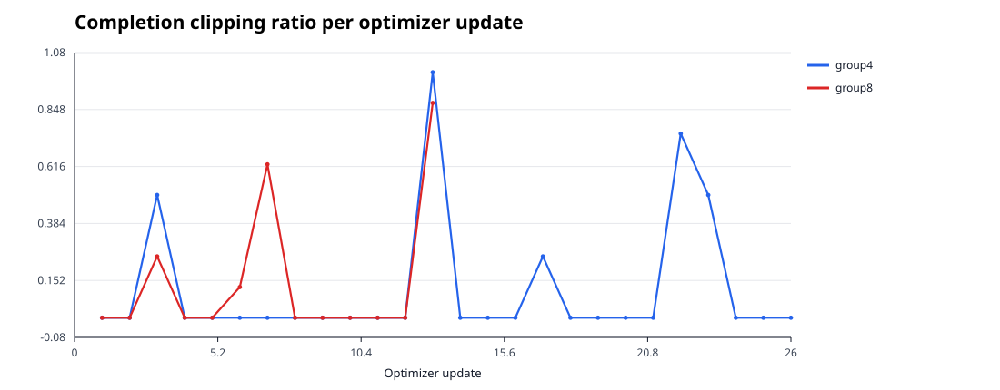

# Qwen3-0.6B 本地 GRPO 实验报告

执行时间：2026-10-22 UTC 至 2026-10-23 Asia/Shanghai。全部训练和评测在本地 WSL2 RTX 3060 上完成；没有租用或使用 AutoDL/其他云端 GPU。模型和公开数据文件下载到本地缓存。

## 结果摘要

- 最小正确性检查通过；1 步 smoke 完成真实反向传播与优化器更新。
- 12 步小训练完成，LoRA 权重发生可量化变化，保留了完整 Trainer checkpoint 和最终 adapter。
- 全程没有 OOM，因此未启用显存回退。
- 固定 48 题留出集上，基座 exact-match 为 24/48（50.0%），微调后为 32/48（66.7%），增加 16.7 个百分点。这只是小样本 sanity 结果，不足以证明稳定泛化提升。
- 另完成固定 GSM8K revision 的本地 RLVR pilot：validation 选中的 group-4 step-4 在独立 test2 子集为 33/128（25.78%），base 为 12/128（9.38%）。这是单 seed、小子集结果；输出 token 与推理耗时明显增加，尚不能视为稳定提升或效率优化。
- 在未用过的 GSM8K source rows 上比较两个约16k生成token的奖励pilot。预锁定规则选中exact-format checkpoint-13（validation 190/500，距离奖励183/500，配对p=0.547）；随后在新的1,000题test上为336/1,000（33.6%），基座97/1,000（9.7%），paired McNemar p=2.37e-46。该结果是单seed、13次更新的小pilot；不能说两种reward间有已验证差异，也不能说效率提升（该模型生成2.68倍token、推理用时4.86倍）。
- 完成约16k生成token预算的group4/group8对照，按validation选择group8（176/500 vs139/500，paired p=0.000341）。在新的1,000题test上group8为354/1,000（35.4%），base为99/1,000（9.9%），paired p=2.12e-52；单seed短pilot，adapter生成2.55倍tokens、耗时4.58倍，不代表效率收益或多seed稳定提升。

## 环境审计

首次安装前，WSL2 能看到 RTX 3060，但 PyTorch、Transformers、TRL、PEFT、Accelerate 和 bitsandbytes 均未安装。最终训练环境如下：

| 项目 | 审计结果 |
|---|---|
| 系统 | WSL2 / Ubuntu 24.04.3 LTS，Linux kernel 6.6.87.2 |
| Python | 3.12.3；虚拟环境 `/home/zihao/.venvs/qwen3-grpo` |
| GPU | NVIDIA GeForce RTX 3060，12,288 MiB，compute capability 8.6 |
| NVIDIA driver | 537.58；`nvidia-smi` 报告 driver CUDA 12.2 |
| PyTorch | 2.5.1+cu121；PyTorch CUDA runtime 12.1；CUDA 可用，BF16 可用 |
| Transformers / TRL | 4.57.3 / 1.16.0 |
| PEFT / Accelerate | 0.21.2 / 1.15.0 |
| Datasets / bitsandbytes | 4.7.0 / 0.50.2 |
| NumPy | 2.5.4 |
| 最终 `pip check` | 无依赖冲突 |

开始训练前最后一次环境审计记录到 2,057 MiB 已用、10,066 MiB 可用；最初审计为 2,111 MiB 已用、10,012 MiB 可用。占用主要来自桌面显示进程。逐次训练的 GPU 峰值是 0.5 秒间隔 `nvidia-smi` 采样到的整卡数字，包含桌面/其他进程；另列 PyTorch allocator 指标，二者不能相互替代。

环境完整记录见 `environment_preinstall.json` 和 `environment.json`。

## 模型、数据与可验证奖励

- 模型：`Qwen/Qwen3-0.6B`，固定 revision `c1899de289a04d12100db370d81485cdf75e47ca`。
- 训练数据：256 条固定种子的整数加减乘题；SHA-256：`9493e73bcd6eb59f281449308fd0626dea9e41a7d3f2fbdfca5f7163846df011`。
- 验证集：96 条题目；SHA-256：`016c7a94489a2827f3b22eebf82b64d242f9f9679391311e1993c0ba606f276d`。按固定种子生成，并在采样时排除 train 与 final eval 已出现的题目。
- 最终评测集：48 条独立种子题；SHA-256：`fef149b7c763de8edc4e75d470e7dba79424891547c7f910ae7d4888b8705107`。
- `validate_reward.py` 对已保存 JSONL 与确定性生成器逐行比对，train/validation/eval 三组 prompt 文本交集均为 0。训练集 256 行中有 252 个唯一 prompt（4 行重复），验证集和评测集内无重复；正式数据应去重训练样本。
- 奖励只从唯一 `<answer>整数</answer>` 或唯一 `\boxed{整数}` 解析最终答案；未标记答案或多个答案标记不给分。正确答案加 1.0，正确 XML 格式加 0.05，距离 shaping 最多加 0.1。
- 5 项奖励/解析单测全部通过；包含正确、错误、无格式、重复标签和 boxed 负整数。

## 训练配置与实测指标

两次训练都使用 NF4 4-bit 基座、double quant、BF16 计算、LoRA `r=8 / alpha=16 / dropout=0`，注入 q/k/v/o/gate/up/down 投影；启用非 reentrant gradient checkpointing，单卡 Transformers 原生生成，`use_vllm=False`。没有加载 reference model（`beta=0`）。

| 指标 | 正确性 smoke | 小规模训练 |
|---|---:|---:|
| Prompt / completion token 上限 | 96 / 32 | 128 / 64 |
| Generation group / 梯度累积 | 2 / 2 | 4 / 4 |
| 优化器更新 | 1 | 12 |
| 训练耗时 | 24.35 秒 | 43.95 秒 |
| 更新速度 | 0.041 step/s | 0.273 step/s |
| Completion 速度 | 0.082 completion/s | 1.092 completion/s |
| 实际生成 token / 速度 | 51 / 2.09 token/s | 1,111 / 25.28 token/s |
| 平均训练 reward | 0.575 | 0.766（每步均值的算术平均） |
| reward 范围 | 0.575 | 0.000–1.150 |
| 零组内 reward 方差 | 0/1 步 | 5/12 步 |
| PyTorch 峰值 allocated / reserved | 1,107 / 1,432 MiB | 1,107 / 1,432 MiB |
| 采样整卡 GPU 峰值 | 4,457 MiB | 4,491 MiB |
| OOM / 回退 | 无 / 无 | 无 / 无 |

小训练共有 5,046,272 个可训练 LoRA 参数，其中 4,170,816 个参数在最终模型中发生变化；LoRA 参数绝对更新量之和为 638.29。训练日志 12 步 loss、reward 和 grad norm 均为有限数；7 步 grad norm 大于零，5 步 grad norm 为零。后 5 步正好对应组内 reward 方差为零，因此这些步没有有效的组内相对偏好信号；报告该情况供解释训练 reward 和后续正式配置时参考。

## Validation 选 checkpoint

先固定规则：按 validation exact-match accuracy 选 checkpoint；并列时选更早的 checkpoint。使用独立进程从 checkpoint 目录重载 adapter，在同一个 96 题 validation 集上贪心评测：

| Checkpoint | 正确题数 | Accuracy | 解析率 | 耗时 / 吞吐 |
|---|---:|---:|---:|---:|
| step 8 | 63/96 | 65.63% | 68.75% | 87.15 秒 / 29.28 token/s |
| step 12 | 65/96 | 67.71% | 69.79% | 68.58 秒 / 26.51 token/s |

因此选择 `checkpoint-12`。该选择只依据 validation；`quality_gate.json` 记录了候选、规则、hash 和 selected path。最终评测集 SHA 与 validation 不同，也没有用于选择模型。最终 adapter 的权重与 step 12 checkpoint 权重 SHA-256 相同。

## 独立留出评测

评测由独立进程加载基座或已保存 adapter，使用 greedy decoding、`max_new_tokens=48`、关闭 thinking；基座和 12 步模型使用同一最终评测文件及 seed。step 8/12 checkpoint 选择另用独立 validation 集。

| 模型 | Exact match | 解析率 | 耗时 / 生成吞吐 | PyTorch 峰值 allocated / reserved | 整卡采样峰值 |
|---|---:|---:|---:|---:|---:|
| 基座 | 24/48（50.0%） | 25/48（52.1%） | 41.92 秒 / 32.92 token/s | 820 / 846 MiB | 4,116 MiB |
| 12 步 adapter | 32/48（66.7%） | 32/48（66.7%） | 40.31 秒 / 22.03 token/s | 820 / 862 MiB | 4,509 MiB |

小评测集存在较大统计波动，评测准确率不能替代正式数学基准，也不应用训练 reward 选取正式模型。逐题预测、解析结果和准确率都保存在评测 JSON 中。测试结果显示本模型小样本 exact-match 上升，但这并不能证明通用数学推理能力提升。

## GSM8K 多步数学 RLVR pilot

算术实验验证了训练接口，但任务过于简单。后续 pilot 改用固定 revision 的 [`openai/gsm8k`](https://huggingface.co/datasets/openai/gsm8k/blob/740312add88f781978c0658806c59bc2815b9866/README.md)：官方数据卡将其描述为需要多步推理的年级数学题并列出 MIT 许可；上游 MIT 文本保存在 `data/gsm8k/LICENSE`。本地划分由固定样本种子生成，最终答案严格解析自来源答案末尾 `#### integer`，不符合整数格式的数据会使准备脚本失败。

| Split | 数量 | SHA-256 | 用途 |
|---|---:|---|---|
| train | 256 | `61cf86d39c754b0867b91547d8445afbcfe48a78dfd085d364f7ba6143c640bd` | GRPO |
| validation | 96 | `198be3c7a638cbbf6f71df4469dd30df5653d974ebf072dcac691ea04434fe16` | 选择 checkpoint |
| test（slice 1） | 128 | `ee7c56ff8834669a354c5b4eda69fdca8741471e0800872d82974fa64ca30ca8` | 初轮开发诊断；之后用于比较采样组，不作最终留出结论 |
| test2（slice 2） | 128 | `d422c8ecffd4aefcbcc8ded6de47b4d05970470da56cfaa028b6b7d3faf86350` | 最终 pilot 对照，选择 checkpoint 前未查看 |

四个 split 的题目文本均不重叠，逐行 JSONL hash 与 pinned manifest 匹配。训练配置都使用同一 Qwen3 revision、NF4 QLoRA、BF16、LoRA r=8/alpha=16、gradient checkpointing、`use_vllm=False`、学习率 `5e-5`、prompt 上限192和 completion 上限160。唯一主要变量为 GRPO group 与更新数；两组各采样16条 completion，但不是相同 token 或时间预算，因此这只是采样组探索，不是公平的效率消融。

| 训练条件 | Updates / group | Completion 数 / token 数 | train 时间 | 平均 reward / 平均组内 std | 被截断更新 | PyTorch allocated/reserved 峰值 | 整卡采样峰值 |
|---|---:|---:|---:|---:|---:|---:|---:|
| group 2 | 8 / 2 | 16 / 304 | 24.08 秒 | 0.05296 / 0.01094 | step 2 有部分截断 | 1,117/1,432 MiB | 4,193 MiB |
| group 4 | 4 / 4 | 16 / 1,225 | 40.58 秒 | 0.24082 / 0.29572 | step 4 的4条全到160-token上限 | 1,144/1,432 MiB | 4,132 MiB |

两组都完成真实 LoRA 更新、日志数值有限、保留 optimizer/RNG/Trainer checkpoint，且无 OOM。按 validation exact-match 最高者从四个候选 checkpoint 中选出 group-4 step-4：base 为8/96（8.33%），group-2 step-4/8 均为4/96（4.17%），group-4 step-2 为14/96（14.58%），group-4 step-4 为29/96（30.21%）。所有候选都在同一 validation hash 上由独立进程重载评测；选择规则和实际结果见 `gsm8k_checkpoint_selection.json`。

在选择完成后，对未参与选模的 test2 做 base 与所选 checkpoint 的同协议对照（greedy，max_new_tokens=192，thinking 关闭）：

| 模型 | Exact match | 解析率 | 输出 token / token/s | 耗时 | PyTorch allocated/reserved | 整卡采样峰值 |
|---|---:|---:|---:|---:|---:|---:|
| Base | 12/128（9.38%，95% Wilson CI 5.44–15.67%） | 78.13% | 5,188 / 49.30 | 105.23 秒 | 820/878 MiB | 3,520 MiB |
| 选中 group-4 step-4 | 33/128（25.78%，95% Wilson CI 18.99–33.99%） | 69.53% | 15,455 / 29.25 | 528.31 秒 | 820/900 MiB | 3,669 MiB |

test2 上两个模型对同一批题逐题配对：7 题都答对、5 题 base-only 正确、26 题 selected-only 正确、90 题都错；精确 McNemar 双侧 p=0.00019。该结果支持“这次固定采样下准确率上升”的描述，但只有128题、单 seed，而且所选模型生成约3倍 token、推理时间约5倍，解析率也低8.6个百分点；不应据此声称已获得普遍、稳定的 GSM8K 提升或训练加速。

首个 test slice 的早期开发诊断为 base 13/128、group-2 step-4 4/128；看到该结果后才探索 group 4。它不用于最终结论。test2 在 group-4 checkpoint 选择前保持未查看。训练 step-4 的 completion 截断率为100%，下一轮须先扩大长度预算并测显存/截断，然后用更多 updates 和新 seed 重复；另需给效率比较匹配生成 token 或 GPU 时间预算。

## Formal split 长度与组大小 profile

为决定本机12GB显存上的下一轮配置，在正式 split 的训练数据上分别做了1步 group-4 与 group-8 profile，seed `20261023`，prompt/completion 上限均为256，并保存了完整 checkpoint。profile 没有用于模型选取或能力结论；两次只各观察一个随机 prompt batch，completion 实际都较短，不能代表最坏长度或稳定吞吐。

| Group | Completion 数 / 实际 token | 更新耗时 / token 吞吐 | reward mean / std | PyTorch allocated/reserved | 整卡采样峰值 | OOM / 截断 |
|---|---:|---:|---:|---:|---:|---|
| 4 | 4 / 45 | 9.38秒 / 4.80 token/s | 0.05447 / 0.00231 | 1,107/1,432 MiB | 3,774 MiB | 无 / 0% |
| 8 | 8 / 74 | 12.73秒 / 5.81 token/s | 0.05592 / 0.00492 | 1,107/1,432 MiB | 3,769 MiB | 无 / 0% |

group-8比group-4单步生成更多token且用时增加，但不同completion数、短样本和不同采样结果使这一比较不能说明质量或效率优劣。随后以group-8、256-token completion上限完成100步扩展pilot；训练与选模结果见下节。两个profile运行记录见 `runs/profile-g4-c256/` 和 `runs/profile-g8-c256/`。

## Formal split 的100步扩展pilot

在固定正式训练split上完成group-8、100次optimizer update（seed `20261023`，学习率 `5e-5`，prompt/completion上限256）。运行记录的Git commit为 `c0c36832c2aa95d89ddcf84aff5e13f14ea1d871`；数据hash、配置、完整 reward/gradient history、completion parquet及checkpoint均保存在 `runs/gsm8k-formal-g8-100/`。

| 指标 | 结果 |
|---|---:|
| Optimizer updates / rollout group | 100 / 8 |
| Completion 数 / 生成 token 数 | 800 / 8,603 |
| 训练耗时 / step/s / completion/s / token/s | 271.21秒 / 0.369 / 2.950 / 31.72 |
| 平均训练 reward | 0.07811 |
| 零组内 reward 方差 / 零 gradient step | 4/100 / 4/100 |
| completion 截断 | 0/100 步 |
| 发生变化的 LoRA 参数 | 4,183,041 / 5,046,272 |
| PyTorch 峰值 allocated / reserved | 1,435 / 1,512 MiB |
| 整卡采样峰值 | 4,136 MiB |
| OOM / fallback | 无 / 无 |

validation按预先固定的exact-match规则选择step50与step100中更好的step100；但它仍低于同一validation上的基座：基座46/500（9.2%），step50为9/500（1.8%），step100为24/500（4.8%）。adapter解析率提高至97.6%，基座为74.8%，但格式改善没有转化为答案正确率。该运行因此是负向的扩展诊断，不支持能力提升结论。对训练parquet离线审计发现800条completion中只有18条精确正确（2.25%），754条能解析（94.25%），平均错误答案绝对距离为342.9；100个group中只有4组reward完全相同，对应4个零gradient步骤。零方差只占4%，不能单独解释准确率下降；大量错误但格式正确、距离很远的答案仍获得约0.05格式分和很弱的距离分，提示策略主要学会格式而未学会求解。step50/100均由独立进程重载并在相同500题、max-new-tokens192评测。

进一步按组统计，只有11/100组出现过正确答案，另有89组完全没有正确答案；其中仅4组reward方差为零，85组虽然全错仍因数值距离不同而产生非零方差。无正确答案组的平均reward标准差为0.00764，而出现正确答案组为0.416。当前`scale_rewards="group"`会将每组reward按组内统计量缩放，因此微弱的错误答案距离差异也可能为这85组提供相对优势。这是无效更新的一个可能来源。

据此新增`exact_format`奖励消融：正确整数得1分，唯一`<answer>`格式另加0.05分，错误整数不再按距离分层；原有奖励保留为`distance_shaped`对照。训练脚本还新增按真实生成completion token预算停止的回调，用于将两个条件配到约16,000个生成token并记录组边界造成的实际超额。新奖励已通过独立单元案例；两种奖励在新鲜split上的短程训练对照和 validation 选择均已完成，test 只在候选规则锁定后开启。

新鲜split上尚未训练前的基座验证已完成：54/500（10.8%）精确正确，解析率76.0%，生成21,635 token，耗时396.45秒（54.57 token/s），PyTorch峰值allocated/reserved为820/882 MiB，采样整卡峰值3,481 MiB。新测试集仍未运行模型。以`token-budget-smoke`验证停止回调：目标1 token时完成1次真实optimizer update、8条completion、274 token，LoRA参数变化2,748,622个，step-1 checkpoint已保存；训练耗时15.24秒，峰值整卡3,940 MiB。随后用`terminal-checkpoint-smoke`验证预算在保存间隔前触发时也保存完整终态checkpoint：目标1、实际222 token、1次更新、8条completion，LoRA变化2,751,773个，训练10.05秒，22.08 token/s，峰值allocated/reserved 1,217/1,432 MiB、整卡3,920 MiB。checkpoint-1含optimizer/scheduler/RNG/Trainer状态，已从独立进程重新加载并在1条临时validation样本上成功生成。以上只验证工程链路，不作为性能结果。

### Fresh split 16k-token 距离奖励 pilot

为观察新split的生成长度和训练预算回调，先在group-8、256 completion上限下运行`distance_shaped`小pilot。运行12次更新，抽到12个不同训练prompt；96条completion生成17,502 token，较16,000目标超出1,502（9.4%）。训练耗时155.71秒，112.40 token/s；PyTorch峰值allocated/reserved为1,638/1,834 MiB，整卡峰值4,430 MiB，无OOM/回退。

这12个训练prompt上有16/96条精确正确（16.7%），解析率47.9%，XML答案标签率18.8%；这是训练rollout的样本内诊断，不能和500题基座validation直接比较。8/12组至少有一条completion被截断，平均组内截断比例31.25%（估算约30/96条）；3/12组reward方差及梯度为零。错误且可解析答案的平均绝对距离为49,588。该pilot因此不能作为策略效果结论，也提示256-token上限和旧距离奖励都可能产生大量无效样本。因为token预算在第25步保存间隔之前触发，首个pilot只保存final adapter；训练代码随后补上预算停止时保存完整终态Trainer checkpoint。逐条rollout见`reports/gsm8k_next_fresh_distance16k_rollout_audit.json`。

在完全相同的train split、seed、group 8、学习率、256-token长度上限和16,000-token目标下，完成了`exact_format`奖励对照。距离奖励组为12次更新/96条completion/17,502 token，训练155.71秒、112.40 token/s、整卡峰值4,430 MiB；exact-format组为13次更新/104条completion/17,272 token，训练159.52秒、108.28 token/s、整卡峰值4,384 MiB。两组均无OOM，预算超额分别为9.4%和8.0%。训练rollout精确正确率为16.7%（16/96）与20.2%（21/104），解析率47.9%与58.7%，平均completion截断比例31.25%与20.19%；两组都各有3个零方差/零梯度更新。以上是13个prompt左右的样本内诊断，不能说明validation泛化或奖励改进。距离组只有final adapter，没有完整终态resume checkpoint；exact-format组的checkpoint-13含完整状态。validation候选路径与选模规则已在`reports/gsm8k_next_fresh_reward_selection_plan.json`预先锁定。

下图从 Hugging Face `trainer_state.json` 自动导出，CSV 明细在`reports/curves/training_curves.csv`。reward 两种模式的数值尺度不同，reward 曲线只作训练诊断，不横向解释成性能差异；截断率曲线表示每步 completion 撞上长度上限的比例。





### Fresh split validation 选择与 test 对照

两候选均在固定 fresh validation（500题，SHA-256=`4134f3804b0fab799b5db3ae58da2ac28c8955ad48bcd29becf928e4cf551ee6`）上用同 seed、greedy decoding、`max_new_tokens=192`、关闭 thinking 独立重载评测。基座为54/500（10.8%，Wilson 95% CI 8.37–13.83%）。距离奖励候选为183/500（36.6%，CI 32.49–40.91%），解析率59.2%，生成78,098 token，耗时2,548.25秒（30.65 token/s），PyTorch峰值allocated/reserved为820/904 MiB，整卡峰值3,510 MiB。exact-format候选为190/500（38.0%，CI 33.85–42.33%），解析率72.8%，生成68,487 token，耗时2,260.85秒（30.29 token/s），PyTorch峰值820/902 MiB，整卡峰值3,506 MiB。两组validation逐题配对为都正确137题、仅距离奖励正确46题、仅exact-format正确53题、都错264题；精确McNemar双侧p=0.547。虽然预先注册的“最高 exact-match”规则选中exact-format，但7题净差异不显著，因此不能据此声称两种奖励有确定的泛化差异。规则、数据hash、checkpoint、置信区间和完整配对统计写入`reports/gsm8k_next_fresh_reward_selection.json`；test未参与选择。

按照锁定规则选择`runs/gsm8k-next-fresh-g8-exact-format-16k/attempt-01/trainer/checkpoint-13`后，才打开此前封存的1,000题fresh test（SHA-256=`355bc1cb7de1e61863364ea4790b2223dac405295bc2ad6ee160b2d741ca212e`）。基座和选中adapter各评估一次，使用相同贪心解码、`max_new_tokens=192`、关闭thinking：

| 模型 | Exact match | Wilson 95% CI | 解析率 | 生成token / token/s | 耗时 | PyTorch allocated/reserved | 整卡采样峰值 |
|---|---:|---:|---:|---:|---:|---:|---:|
| 基座 | 97/1,000（9.7%） | 8.02–11.69% | 72.9% | 52,270 / 55.38 | 943.81秒 | 820/886 MiB | 3,485 MiB |
| exact-format checkpoint-13 | 336/1,000（33.6%） | 30.74–36.59% | 68.1% | 140,260 / 30.60 | 4,583.68秒（76.4分钟） | 820/908 MiB | 3,512 MiB |

配对题目中两者都正确60题、仅基座正确37题、仅adapter正确276题、两者都错627题；精确McNemar双侧p=2.37×10^-46。该checkpoint在这份独立held-out split上比基座高23.9个百分点，但生成token约为基座2.68倍、耗时约4.86倍，token/s也较低；不能把它表述成效率提升。该结论来自一个短程、单seed训练，且validation上两奖励候选差异不显著，故只能说本轮选中的exact-format策略在此fresh test上优于基座，不能断言优势由奖励模式造成或已具备跨seed稳定性。test只用于这次最终基座/选中adapter对照，不用于调参；逐题结果与配对统计见`reports/gsm8k_next_fresh_final_test_audit.json`。另有独立的source/eval去重审计：test 1,000行与所有历史training split及4,908条历史模型预测均无重叠；其中184行也存在于此前准备但废弃、从未用于训练或模型评测的`data/gsm8k-next/test.jsonl`，为透明起见在`reports/gsm8k_next_fresh_holdout_audit.json`记录。

### Phase C：匹配生成 token 预算的 group-size 对照

为回应“固定计算量下 group size 如何影响更新质量与效率”，在训练前锁定`reports/gsm8k_phasec_group_selection_plan.json`：比较`exact_format`、同一1,500条训练数据、seed 20261025、学习率`5e-5`、prompt/completion上限256、目标16,000个实际生成completion token；group4与group8的completion总数都为104，达到预算后在完整组边界停止。候选按新固定500题validation exact-match最高者选择，并列时依次选较少训练token、较少更新。该split来自之前未使用的官方train source rows；source index审计排除了先前数据中的6,769行。validation SHA-256=`71a364db575724e0b2a610040a15112775845b1f98b59c3c99b8c913f94ff5f7`，封存test SHA-256=`eb9e38a7728c28d1f9c7fdd6a907aad06b89c2ab04f0de922a31406f655540eb`。基座在此validation为44/500（8.8%），解析率80.6%，生成22,588 token，407.08秒、55.49 token/s，PyTorch allocated/reserved峰值820/880 MiB、整卡峰值3,479 MiB。

| 条件 | 更新 / 不同prompt | completion / 生成token | 训练秒 / token/s / step/s | rollout exact-match / 解析率 | 组内零方差 / 零梯度更新 | completion截断比例 | PyTorch allocated/reserved峰值 | 整卡峰值 | checkpoint |
|---|---:|---:|---:|---:|---:|---:|---:|---:|---|
| group4 | 26 / 26 | 104 / 16,097（+0.6%） | 234.42 / 68.67 / 0.111 | 40/104（38.46%） / 75.96% | 2 / 2 | 11.54% | 1,239/1,432 MiB | 3,968 MiB | `runs/gsm8k-phasec-exact-g4-16k/attempt-01/trainer/checkpoint-26` |
| group8 | 13 / 13 | 104 / 16,354（+2.2%） | 153.05 / 106.85 / 0.085 | 37/104（35.58%） / 69.23% | 0 / 0 | 14.42% | 1,622/1,792 MiB | 4,399 MiB | `runs/gsm8k-phasec-exact-g8-16k/attempt-01/trainer/checkpoint-13` |

group8以更大组采样取得更高训练token吞吐，但在本机峰值整卡多用431 MiB、PyTorch reserved多用360 MiB；group4每个prompt采样更少，因此相同104条completion覆盖26个prompt，group8覆盖13个prompt。两组均有真实LoRA变化和完整Trainer checkpoint，OOM/fallback均为0。训练rollout指标是样本内信号，不用于模型选型；最终validation accuracy、逐题配对与独立test结论见后续Phase C评测记录。训练 reward/clipping 诊断曲线及原始CSV见`reports/curves_phasec/`，完整rollout审计分别在`reports/gsm8k_phasec_g4_rollout_audit.json`与`reports/gsm8k_phasec_g8_rollout_audit.json`。





### Phase C validation 选型与测试评估

两候选及基座在相同500题 validation 上由独立进程重载评估，使用greedy decoding、`max_new_tokens=192`、关闭thinking、seed 20261025。结果如下：

| 模型 | Exact match | Wilson 95% CI | 解析率 | 生成token / token/s | 耗时 | PyTorch allocated/reserved | 整卡采样峰值 |
|---|---:|---:|---:|---:|---:|---:|---:|
| Base | 44/500（8.8%） | 6.62–11.61% | 80.6% | 22,588 / 55.49 | 407.08秒 | 820/880 MiB | 3,479 MiB |
| group4 | 139/500（27.8%） | 24.05–31.88% | 46.4% | 81,291 / 30.29 | 2,683.53秒 | 820/902 MiB | 3,502 MiB |
| group8 | 176/500（35.2%） | 31.14–39.48% | 74.0% | 65,020 / 30.06 | 2,163.32秒 | 820/900 MiB | 3,499 MiB |

逐题配对比较中，group4与group8同对错106题、仅group4正确33题、仅group8正确70题、同错291题；精确McNemar双侧p=0.000341。按训练前锁定的最高validation exact-match规则选择group8 checkpoint-13（176/500）；相对base的配对为共同正确33题、仅base正确11题、仅selected正确143题、共同错误313题，精确McNemar双侧p=1.90×10^-30。规则、数据hash、候选训练预算、置信区间和逐题配对统计汇总在`reports/gsm8k_phasec_group_selection.json`；完整逐题生成结果分别保存在validation JSON中，test未参与选型。

| 模型 | Exact match | Wilson 95% CI | 解析率 | 生成token / token/s | 耗时 | PyTorch allocated/reserved | 整卡采样峰值 |
|---|---:|---:|---:|---:|---:|---:|---:|
| Base | 99/1,000（9.9%） | 8.20–11.91% | 72.7% | 52,660 / 54.23 | 970.97秒 | 820/886 MiB | 3,485 MiB |
| 选中的group8 adapter | 354/1,000（35.4%） | 32.50–38.41% | 74.0% | 134,062 / 30.16 | 4,444.47秒（74.1分钟） | 820/902 MiB | 3,504 MiB |

group8与base逐题配对后，两者都正确67题、仅base正确32题、仅adapter正确287题、两者都错614题；精确McNemar双侧p=2.12×10^-52。adapter在该测试split上高25.5个百分点，但生成token是base的2.55倍、评测耗时4.58倍，吞吐更低；不能称为推理效率提升。该测试从GSM8K官方train中未用source rows构造，不是官方test split；它在候选锁定后只使用一次。数据隔离审计也通过：逐行source index无历史train/test重叠，逐题文本与历史模型预测输出无重叠（本次base/selected test输出作为当前审计对象排除），见`reports/gsm8k_phasec_holdout_audit.json`。配对门通过，完整统计在`reports/gsm8k_phasec_final_test_audit.json`。

group8在此单seed短pilot的validation上胜出，但其固定训练token预算覆盖13个不同prompt，group4覆盖26个；这是采样组规模自然带来的覆盖差异。test只评估了预先选择的group8，因此不支持“group8在test上胜过group4”的说法。单seed、短训练以及本地训练子集评估都不足以证明普遍的group-size因果结论。

#### Phase C 第二seed复现与机制诊断

Seed 2按训练前锁定的`reports/gsm8k_phasec_seed2_plan.json`重复匹配约16k生成token预算。group4完成25 updates/100 completions/16,160 tokens，训练232.28秒、69.57 token/s、整卡峰值4,070 MiB、Torch峰值allocated/reserved 1,306/1,474 MiB，保存`checkpoint-25`；group8完成13 updates/104 completions/16,415 tokens，训练150.20秒、109.29 token/s、整卡峰值4,506 MiB、Torch峰值1,702/1,910 MiB，保存`checkpoint-13`。两组预算相差1.58%，均无OOM或回退。Seed 2 base validation为49/500，group4为183/500，group8为163/500；按锁定规则选择group4。group4−group8差为+4.0个百分点，paired bootstrap 95% CI[+0.2,+7.8]，精确McNemar p=0.0470。Seed 1反向选择group8：176/500 vs139/500，group4−group8为−7.4个百分点，paired bootstrap 95% CI[−11.4,−3.6]，p=0.000341。两个训练seed的validation赢家相反，因此Phase C group-size结论为MIXED，不能声称固定token预算下某个组大小稳定更优。

两seed rollout都显示group8有更高的正确/错误completion混合组比例：seed1为11/13（84.6%）vs group4 15/26（57.7%）；seed2为10/13（76.9%）vs 14/25（56.0%）。但group8覆盖约一半prompt、更新数约一半，每个正确性混合组消耗约1.9–2.1倍token；其绝对正确性混合组数量反而更少（每seed 10–11组，group4为14–15组）。seed2 group4在zero-variance/zero-gradient组上为6/25，group8为2/13。奖励方差不是数学学习的充分指标，完整分组统计、seed对照、bootstrap与输出审计见[Phase C seed2诊断报告](phasec_seed2_diagnostic_report.md)。

另对保存的rollout做了prompt覆盖交集审计：两个seed中Group8的13个prompt都包含在Group4采样集合内，Group4另覆盖12–13题。共享13题上G4/G8平均exact-match分别为seed1 34.6%/35.6%、seed2 38.5%/37.5%，差值约+1.0和−1.0个百分点，方向同样反转。Group8共享题的正确性混合组为11/13和10/13，Group4为6/13和9/13；但Group8在这些共享题上生成16,354/16,415 token，Group4生成7,006/7,556 token。该事后小样本分析更支持“较大组以更多token增加混合奖励组”，没有显示稳定的共享题正确率优势，也不能作为参数更新效率因果证据。数据与限制见`reports/gsm8k_phasec_prompt_overlap.json`。

按整个16k-token rollout预算计算“正确性混合组 / 1,000生成token”的样本信号密度，Group4在seed1/seed2分别为0.9319/0.8663，Group8为0.6726/0.6092；Group4约高1.39×/1.42×。这是训练样本层面的验证信号密度代理，不是正向梯度或有效参数更新率，也没有扣除不同更新数的反向计算成本，不能据此宣布Group4更优。四次更新后的逐组指标已写回`reports/gsm8k_phasec_*_rollout_audit.json`。

Base与adapter在相同decode设置下评测：`enable_thinking=False`、greedy、`max_new_tokens=192`、同一答案提取器；全量重解析没有发现存储预测与解析器不一致。Seed1的1,000题GSM8K test中base与selected parse rate分别72.7%和74.0%，但未解析且带`<answer>`标记的输出分别占20.5%和4.8%。40题离线样本发现算式代替整数、重复boxed答案及推理到达192-token上限前未交付答案等情况；这些仍按锁定exact-match规则计错，没有事后改分。旧评测JSON没有逐题token长度或finish reason，因此无法全量统计截断率。该主结果衡量的是固定token上限下verifier可读的正确答案，不等同于纯数学推理准确率。

Seed 2 group4的SVAMP外部test已在validation选型后按锁定规则评测：base 267/1,000（26.7%），selected adapter 675/1,000（67.5%），精确McNemar p=2.07e-85，paired bootstrap 95% CI为+37.2至+44.4个百分点。Adapter生成104,482 token、耗时3,697.65秒（61.6分钟，28.26 token/s），base生成35,598 token、耗时730.28秒（12.2分钟，48.75 token/s）；整卡初始使用量分别3,553/3,655 MiB，峰值4,743/4,518 MiB，均无OOM。Adapter输出token约2.94倍、耗时5.06倍，不能称为效率提升。该外部测试只比较validation选中的group4与base，不提供group4对group8的测试比较；SVAMP本轮已消耗，不能复用于后续正式训练评估。完整配对审计见`reports/svamp_phasec_seed2_final_test_audit.json`。

Phase C 的复现命令如下。选择计划需在训练/validation前冻结；test 命令只用于复现实验，不能再次用于调参或选模。

```bash
VENV="$HOME/.venvs/qwen3-grpo/bin/python"
cp reports/gsm8k_phasec_group_selection_plan.json reports/repro_phasec_group_selection_plan.json
$VENV scripts/train_grpo.py --profile formal --train-data data/gsm8k-next-fresh/train.jsonl --run-dir runs/repro-phasec-g4 --reward-mode exact_format --num-generations 4 --max-completion-length 256 --prompt-token-limit 256 --seed 20261025 --learning-rate 5e-5 --max-generated-tokens 16000
$VENV scripts/train_grpo.py --profile formal --train-data data/gsm8k-next-fresh/train.jsonl --run-dir runs/repro-phasec-g8 --reward-mode exact_format --num-generations 8 --max-completion-length 256 --prompt-token-limit 256 --seed 20261025 --learning-rate 5e-5 --max-generated-tokens 16000
$VENV - <<'PY'
import json
from pathlib import Path

plan_path = Path("reports/repro_phasec_group_selection_plan.json")
plan = json.loads(plan_path.read_text(encoding="utf-8"))
roots = {"group4": Path("runs/repro-phasec-g4"), "group8": Path("runs/repro-phasec-g8")}
for candidate in plan["candidates"]:
    root = roots[candidate["candidate_id"]]
    summary = json.loads((root / "run_summary.json").read_text(encoding="utf-8"))
    candidate.update({
        "run_dir": str(root), "adapter": summary["final_adapter"],
        "terminal_checkpoint": summary["checkpoints"][-1],
        "optimizer_updates": summary["optimizer_updates"],
        "generated_tokens": summary["observed_completion_tokens"],
    })
plan_path.write_text(json.dumps(plan, indent=2, ensure_ascii=False) + "\n", encoding="utf-8")
PY
$VENV scripts/eval_math.py --adapter runs/repro-phasec-g4/attempt-01/final_adapter --tag phasec-g4-validation --eval-data data/gsm8k-phasec/validation.jsonl --output reports/repro-phasec-g4-validation.json --max-new-tokens 192 --seed 20261025
$VENV scripts/eval_math.py --adapter runs/repro-phasec-g8/attempt-01/final_adapter --tag phasec-g8-validation --eval-data data/gsm8k-phasec/validation.jsonl --output reports/repro-phasec-g8-validation.json --max-new-tokens 192 --seed 20261025
$VENV scripts/select_group_size_candidate.py --plan reports/repro_phasec_group_selection_plan.json --base-validation reports/gsm8k_phasec_base_validation.json --candidate-validation group4=reports/repro-phasec-g4-validation.json --candidate-validation group8=reports/repro-phasec-g8-validation.json --output reports/repro-phasec-selection.json
$VENV scripts/eval_math.py --tag phasec-base-test --eval-data data/gsm8k-phasec/test.jsonl --output reports/repro-phasec-base-test.json --max-new-tokens 192 --seed 20261025
$VENV scripts/eval_math.py --adapter runs/repro-phasec-g8/attempt-01/final_adapter --tag phasec-selected-test --eval-data data/gsm8k-phasec/test.jsonl --output reports/repro-phasec-selected-test.json --max-new-tokens 192 --seed 20261025
$VENV scripts/audit_eval_pair.py --selection reports/repro-phasec-selection.json --base reports/repro-phasec-base-test.json --selected reports/repro-phasec-selected-test.json --output reports/repro-phasec-test-audit.json --test-manifest data/gsm8k-phasec/manifest.json
```

以上Phase B训练与评测命令如下；复跑时请使用新的空`--run-dir`，保留split/hash和seed不变。若重新训练，必须在候选validation开始前复制选择计划，并按新`run_summary.json`更新adapter路径、实际更新数和实际token数；归档计划锁定的是本轮旧checkpoint。Phase B test已消耗，重跑仅用于复现，不能再次用于模型选择。

```bash
VENV="$HOME/.venvs/qwen3-grpo/bin/python"
$VENV scripts/train_grpo.py --profile formal --train-data data/gsm8k-next-fresh/train.jsonl --run-dir runs/repro-distance16k --reward-mode distance_shaped --num-generations 8 --max-completion-length 256 --prompt-token-limit 256 --seed 20261024 --max-generated-tokens 16000
$VENV scripts/train_grpo.py --profile formal --train-data data/gsm8k-next-fresh/train.jsonl --run-dir runs/repro-exactformat16k --reward-mode exact_format --num-generations 8 --max-completion-length 256 --prompt-token-limit 256 --seed 20261024 --max-generated-tokens 16000
$VENV - <<'PY'
import json
from pathlib import Path
plan = json.loads(Path("reports/gsm8k_next_fresh_reward_selection_plan.json").read_text())
arms = {
    "distance_shaped": Path("runs/repro-distance16k"),
    "exact_format": Path("runs/repro-exactformat16k"),
}
for arm in plan["candidates"]:
    summary = json.loads((arms[arm["reward_mode"]] / "run_summary.json").read_text())
    arm["adapter"] = summary["final_adapter"] if arm["reward_mode"] == "distance_shaped" else summary["checkpoints"][-1]
    arm["optimizer_updates"] = summary["optimizer_updates"]
    arm["generated_tokens"] = summary["observed_completion_tokens"]
plan["status"] = "locked_before_candidate_validation"
plan["test_opened"] = False
Path("reports/fresh_repro_selection_plan.json").write_text(json.dumps(plan, indent=2) + "\n")
PY
$VENV scripts/eval_math.py --tag fresh-base-validation --eval-data data/gsm8k-next-fresh/validation.jsonl --output reports/fresh-base-validation.json --max-new-tokens 192 --seed 20261024
$VENV scripts/eval_math.py --adapter runs/repro-distance16k/attempt-01/final_adapter --tag fresh-distance-validation --eval-data data/gsm8k-next-fresh/validation.jsonl --output reports/fresh-distance-validation.json --max-new-tokens 192 --seed 20261024
$VENV scripts/eval_math.py --adapter runs/repro-exactformat16k/attempt-01/trainer/checkpoint-13 --tag fresh-exact-validation --eval-data data/gsm8k-next-fresh/validation.jsonl --output reports/fresh-exact-validation.json --max-new-tokens 192 --seed 20261024
$VENV scripts/select_reward_candidate.py --plan reports/fresh_repro_selection_plan.json --base-validation reports/fresh-base-validation.json --candidate-validation distance_shaped=reports/fresh-distance-validation.json --candidate-validation exact_format=reports/fresh-exact-validation.json --output reports/fresh-selection.json
$VENV scripts/eval_math.py --tag fresh-base-test --eval-data data/gsm8k-next-fresh/test.jsonl --output reports/fresh-base-test.json --max-new-tokens 192 --seed 20261024
$VENV scripts/eval_math.py --adapter runs/repro-exactformat16k/attempt-01/trainer/checkpoint-13 --tag fresh-exact-test --eval-data data/gsm8k-next-fresh/test.jsonl --output reports/fresh-exact-test.json --max-new-tokens 192 --seed 20261024
$VENV scripts/audit_eval_pair.py --selection reports/fresh-selection.json --base reports/fresh-base-test.json --selected reports/fresh-exact-test.json --output reports/fresh-test-audit.json
```

step100按validation选定后，基座和adapter各自在完整1,063题正式test上贪心评测一次（test SHA-256=`306c5d08ad76236c03c24a7fb60160453fc6e99161c988721893662e5e4f838f`）：

| 模型 | Exact match | 解析率 | 输出token / token/s | 耗时 | PyTorch峰值allocated/reserved | 整卡采样峰值 |
|---|---:|---:|---:|---:|---:|---:|
| 基座 | 95/1,063（8.94%，Wilson 95% CI 7.37–10.80%） | 75.63% | 52,137 / 54.84 | 950.73秒 | 820/888 MiB | 3,490 MiB |
| step100 adapter | 77/1,063（7.24%，Wilson 95% CI 5.83–8.96%） | 98.12% | 11,371 / 29.25 | 388.79秒 | 820/884 MiB | 3,479 MiB |

配对题目中两者都正确14题、仅基座正确81题、仅adapter正确63题、两者都错905题；exact McNemar双侧p=0.156。adapter少生成78.2% token、耗时少59.1%，但准确率低1.69个百分点，且token/s更低；这不是维持任务成功率前提下的成本优化。该正式test已经使用，后续新候选不能再用它调参或选模；需要从尚未查看的GSM8K来源行重新留出测试集，或使用新的独立基准。

## Checkpoint 与复现材料

小训练保留的 Trainer checkpoint：

- `runs/local-small/attempt-01/trainer/checkpoint-8`
- `runs/local-small/attempt-01/trainer/checkpoint-12`
- 最终 adapter：`runs/local-small/attempt-01/final_adapter`

checkpoint 保存 adapter、optimizer、scheduler、RNG 状态和 Trainer 状态，可供续训；评测直接使用最终 adapter。第 12 步 adapter 权重 SHA-256 为 `9fd7d119a81c377bbe752b2b7745648508489c289c4431b51eae4bcd15f5e7d7`；第 8 步权重 SHA-256 为 `c92b2a5e09af8f7e5dfd6d0af261c5104ffaf6a4753a6be02a84b984f303e578`。

完整文件大小与哈希清单在 `artifact_manifest.json`。训练依赖锁 `requirements-wsl2.lock.txt` 的 SHA-256 为 `9b220140188d5ea20bd457a5fffb04b00a3c1f2ce0c528aeabbcd0306a8665d6`。成功运行 summary 另记录模型 revision、数据/代码 hash、优化器更新数、reward log、显存峰值和 checkpoint 路径。

可在 WSL Ubuntu 工作区中用新目录重跑：

```bash
cd /mnt/e/强化学习项目
~/.venvs/qwen3-grpo/bin/python scripts/audit_env.py --output reports/environment.json
~/.venvs/qwen3-grpo/bin/python scripts/check_runtime.py
~/.venvs/qwen3-grpo/bin/python scripts/validate_reward.py
~/.venvs/qwen3-grpo/bin/python scripts/train_grpo.py --profile smoke --run-dir runs/smoke-repro
~/.venvs/qwen3-grpo/bin/python scripts/eval_math.py --tag base --output reports/eval_base.json
~/.venvs/qwen3-grpo/bin/python scripts/train_grpo.py --profile small --run-dir runs/local-small-repro
~/.venvs/qwen3-grpo/bin/python scripts/eval_math.py --adapter runs/local-small-repro/attempt-01/trainer/checkpoint-8 --eval-data data/validation.jsonl --tag step8-validation --output reports/validation_step8_repro.json
~/.venvs/qwen3-grpo/bin/python scripts/eval_math.py --adapter runs/local-small-repro/attempt-01/trainer/checkpoint-12 --eval-data data/validation.jsonl --tag step12-validation --output reports/validation_step12_repro.json
~/.venvs/qwen3-grpo/bin/python scripts/eval_math.py --adapter runs/local-small-repro/attempt-01/final_adapter --tag local-small-repro --output reports/eval_local_small.json
~/.venvs/qwen3-grpo/bin/python scripts/audit_run.py --smoke-run runs/smoke-repro --small-run runs/local-small-repro --step8-validation reports/validation_step8_repro.json --step12-validation reports/validation_step12_repro.json --output-dir reports/repro
```

首次运行需从 Hugging Face 下载模型文件；以上命令的模型推理、反向传播和评测都在本机 GPU 执行。输出目录必须为空，复跑时使用新的目录名。

## 初次兼容性问题

第一次 smoke 暴露已安装 TRL `GRPOConfig` 不接受 `use_cache` 参数。该项已从 Trainer 配置移除，模型 config 保持 `use_cache=False`；修正后的 smoke 完成了有效参数更新。对应失败记录留在 `runs/smoke/attempt-01/failure.json`，成功记录留在 `runs/smoke-v2/run_summary.json`。另一次较新的 Transformers 与当前 PyTorch 组合不兼容，最终固定使用本报告列出的版本并由 `pip check` 验证。

## AutoDL 单张 24GB GPU 正式训练计划

详细迁移步骤见`formal_training_plan.md`。单卡NF4 QLoRA、gradient checkpointing、no-vLLM与完整显存/吞吐/checkpoint记录仍是目标24GB GPU上的技术基线，但Phase C两seed的group-size赢家相反，目前不预设group4或group8。AutoDL训练暂停于新数据方案锁定：GSM8K官方train只剩23条未用source rows，SVAMP 1,000题将在seed2测试后耗尽为独立测试用途。找到新validation与test并完成数据审计后，再更新checkpoint选择计划；仍先做正式长度profile、单步更新和预算核算。旧的“从剩余523条抽500题”与复用SVAMP的命令已失效。任何付费实例仍需用户明确授权。

本机RTX 3060 12GB上，Phase C 500题validation耗时2,163–2,684秒（约30 token/s）；1,000题base test耗时971秒，选中group8 test耗时4,444秒（134,062 token、30.16 token/s）。评测整卡峰值约3.5 GiB；所有训练中整卡峰值最高4,430 MiB（4.33 GiB，Phase B distance-shaped pilot），Phase C group8为4,399 MiB（4.30 GiB），均无OOM。AutoDL型号、容器占用、驱动、训练和长输出评测吞吐需在目标实例重新实测，不能根据型号线性外推。此前“全流程≤2 GPU小时”估计已撤回；迁移计划先做端到端小profile，GPU租用费4小时（按查询价RTX4090最多¥7.52）为硬上限并留0.5小时缓冲，细节见资源计划。

`data/gsm8k-formal/`、`data/gsm8k-next-fresh/`和seed1 Phase C test均已评测并视为消耗。Phase C seed2又从GSM8K官方train取走500条validation source rows，因此历史有效使用量达到7,450/7,473，只剩23条未使用。SVAMP完整1,000题作为seed2 group4/base外部test使用一次后也将视为消耗；它不再是AutoDL独立test。AutoDL正式训练尚未启动，也没有使用云端GPU；下一版计划需锁定新的验证/测试数据源与hash。

新split位于 `data/gsm8k-next-fresh/`：从官方train剩余source rows中排除之前正式实验的2,000个source indices，再采样1,500 train、500 validation和1,000 test。split本身无内部重叠并通过`reports/gsm8k_next_fresh_data_validation.json`；对全部历史training splits和4,908条既有模型预测的额外审计也未发现fresh test重叠。184个test source rows曾出现在被废弃但未用于模型训练/评测的`data/gsm8k-next/test.jsonl`中，这项数据准备史已单独记录。奖励与checkpoint依据validation锁定后，fresh test已按相同协议完成一次基座与选中adapter对照，配对审计见 `reports/gsm8k_next_fresh_final_test_audit.json`。该轮 test 来自GSM8K官方train split，不是官方test split。

## 上游接口依据

- [TRL GRPOTrainer 文档](https://huggingface.co/docs/trl/grpo_trainer)
- [Qwen3-0.6B 固定 revision 模型卡](https://huggingface.co/Qwen/Qwen3-0.6B/tree/c1899de289a04d12100db370d81485cdf75e47ca)
- [Qwen3 模型卡与 thinking 选项](https://huggingface.co/Qwen/Qwen3-0.6B)

## Phase C final archive: post-hoc output length and inference cost

After both seeds and their one-time tests were frozen, the saved per-question Base/selected-adapter predictions were analyzed offline. This is explicitly **post-hoc**: it did not re-run inference, modify answer extraction, revise historical exact-match accuracy, change checkpoint choice, or alter the locked test protocol. `reports/posthoc_prediction_length_audit.md` includes output character/word counts, optional local Qwen-tokenizer re-tokenization, paired correctness changes, unparsed output counts, and the original aggregate token/time measurements.

The adapters scored 354/1,000 vs Base 99/1,000 on seed 1 GSM8K and 675/1,000 vs Base 267/1,000 on seed 2 SVAMP. Unparsed predictions were 260 vs 273 for seed 1 and 114 vs 167 for seed 2 (adapter vs Base). The selected adapters generated 134,062 vs 52,660 aggregate tokens and took 74.1 vs 16.2 minutes on seed 1; on seed 2 they generated 104,482 vs 35,598 tokens and took 61.6 vs 12.2 minutes. Higher exact-match co-occurred with more output tokens and much longer runtime; neither result is an inference-efficiency gain.

Mean re-tokenized decoded-text lengths were not uniform across correctness: on seed 1 GSM8K, adapter outputs averaged 116.4 tokens when correct and 142.4 when incorrect (Base 99.8 / 46.4); on seed 2 SVAMP, adapter averaged 93.7 / 123.9 (Base 63.4 / 24.1). These are post-hoc tokenizations of saved strings, not original generated token IDs, because per-question token IDs and latency were not retained. Longer output therefore does not imply higher answer quality, and the association is not causal. Original generated-token totals, exact-match scores, paired tests, and checkpoint-selection records remain authoritative and unchanged.
